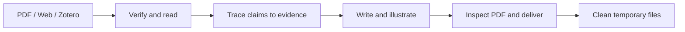

<div align="center">

# 📚 Research Paper Report

### Read the paper. Follow the evidence. Keep the insight.

A Codex skill that turns academic papers into concise, illustrated reading reports.

[](SKILL.en.md)
[](#-bring-your-papers)
[](#-from-source-to-report)
[](LICENSE)

**English** · [简体中文](README.zh-CN.md)

[Quick start](#-quick-start) · [Report contents](#-whats-inside-a-report) · [How it works](#-from-source-to-report) · [FAQ](#-a-few-useful-answers)

</div>

---

## ✨ A paper summary you can think with

What problem does this paper actually solve? Which ideas are new? Do the experiments support the claims?

This skill follows those questions from the task background to the final evidence. It brings together **the method's foundations, selected results, and an independent assessment** in a report you can revisit without rereading the whole paper.

- 🧭 **Start with the task.** Understand the inputs, outputs, assumptions, and research field before diving into the method.
- 🧬 **Trace the ideas.** See the prior-work timeline and distinguish inherited components from new contributions.
- 🗺️ **Follow the method.** Every report includes a workflow diagram matched to the module explanations. Prefer the paper's overview; prepare an attributed diagram from the methods text when needed.
- 🖼️ **See the difference.** Include one or two key qualitative comparisons when available, alongside the main metrics and useful ablations.
- 🔎 **Question the claims.** Check strong baselines, fair comparisons, failure cases, and what the evidence actually establishes.
- 📚 **Bring a batch.** Mix PDFs and links; get a separate report for each paper. An inaccessible item does not stop the others.
- 🧹 **Keep the workspace light.** Clean up task-created downloads and temporary files after verification, while preserving user originals.

> **Default output:** one Chinese PDF per paper, approximately **4–5 A4 pages** and **2,500–3,500 Chinese characters**. Ask for English, a different length, or another format whenever needed.

## 📥 Bring your papers

- **📄 PDF files** — local files or uploaded attachments; scans can use OCR when available.
- **🌐 Paper webpages and DOI links** — use complete HTML or an accessible PDF, whichever works best.
- **📎 Zotero citations and links** — drag or copy a citation, external link, or accessible attachment.
- **🗂️ Mixed batches** — provide several papers in one request without converting them to the same format.

Zotero support uses the material you supply. It does not connect to your entire library, and an internal `zotero://` link alone may not provide readable full text.

## 🚀 Quick start

### 1. Install the skill

Download this repository using **Code → Download ZIP**, then extract it. Copy its contents into a folder named `paper-reading-report` under `$CODEX_HOME/skills`, or `~/.codex/skills` when `CODEX_HOME` is unset.

The layout should be:

```text
~/.codex/skills/paper-reading-report/SKILL.md
```

The repository is named **`research-paper-report`**; the installed skill and invocation remain **`paper-reading-report`**.

For the default location, you can also install with Git:

```sh
git clone https://github.com/ypqlvkxx/research-paper-report.git "$HOME/.codex/skills/paper-reading-report"
```

If you use a custom `CODEX_HOME`, adjust the destination to its `skills/paper-reading-report` directory.

This is an instruction-based skill, not a standalone application. It needs a Codex environment with file tools and PDF extraction, generation, rendering, and inspection capabilities. An available PDF skill can provide that workflow. Web retrieval needs network access; scans may need OCR; Chinese output needs compatible fonts.

### 2. Attach a paper or paste a link

Start a new Codex chat, add your inputs, and use one of these prompts.

**📄 One paper**

```text
Use $paper-reading-report to read the attached paper and generate a concise PDF report.
```

**📚 A batch of papers**

```text
Use $paper-reading-report for these PDFs and paper links.
Create one separate PDF report per paper. If a paper is inaccessible,
explain why and continue with the others.
```

**🌍 A report in English**

```text
Use $paper-reading-report to analyze this paper in English.
Keep the PDF to about five pages and include the most informative visual comparisons.
```

## 🧠 What's inside a report?

The report moves from **“What is the task?”** to **“What is worth taking away?”** Sections may be combined to stay concise.

<details>
<summary><strong>🧭 Understand the problem and its history</strong></summary>

- Specific research fields and paper identity.
- Task background: purpose, input data, required assumptions, and output form.
- A one-sentence summary and a short paragraph covering the motivation, approach, and findings.
- A timeline of prior methods, their stated limitations, and whether those criticisms are justified.
- Direct foundations: earlier papers, backbones, pretrained models, datasets, and postprocessing.

</details>

<details>
<summary><strong>🔬 Understand the method and inspect the results</strong></summary>

- Core innovations and a concise explanation of the method modules.
- At least one method workflow diagram beside the method explanation, with matching module names, clear inputs and outputs, and source attribution. Key equations are optional additions.
- Datasets, splits, baselines, training settings, available parameter counts, and resource costs.
- Selected main results and necessary ablations.
- One or two qualitative comparison figures when provided, in addition to the method diagram, with concrete observations about improvements and remaining defects.

</details>

<details>
<summary><strong>⚖️ Judge the evidence and the contribution</strong></summary>

- Whether the evidence supports the individual modules and broader applicability.
- A grounded quality assessment: is the idea simple and effective, and at what implementation or resource cost?
- Two or three future directions tied to actual limitations.
- Where the novelty lies: method, data, training, engineering integration, or problem framing.
- Sources, figure and table references, and the actual reading and verification scope.

</details>

Read the full [English report outline](references/report-outline.en.md) or [中文报告模板](references/report-outline.md).

## 🔄 From source to report



For batches, each paper has its own evidence records, temporary directory, and output filename. Duplicate inputs for the same paper are grouped after checking identity and version. Failed items are listed with their reasons; completed reports remain available.

## 🤔 A few useful answers

<details>
<summary><strong>What happens if a paper is behind a paywall or CAPTCHA?</strong></summary>

The skill explains the actual obstacle and stops retrieval for that paper. It makes only limited, justified retries for transient connection failures. It does not treat an abstract or repository README as a full-paper reading. A local PDF or another readable source lets the task resume.

See the [access guidance](references/web-access.en.md).

</details>

<details>
<summary><strong>Will it simply repeat the authors' claims?</strong></summary>

The workflow asks for independent assessment: check comparison conditions, separate inherited techniques from novelty, assess ablations, and flag unsupported claims. Missing details are labeled as unreported. Figures and results must come from the paper or its actual data; unavailable evidence is not invented. Reading and reporting do not imply reproducing the experiments.

</details>

<details>
<summary><strong>What gets deleted?</strong></summary>

By default, retain each final report and remove task-created downloads, supplements, extracted text, rendered pages, crops, and temporary scripts after verification. Preserve user-provided PDFs, Zotero attachments, existing reports, and unrelated files. You can explicitly request additional artifacts to be kept.

</details>

<details>
<summary><strong>Are the skill instructions available in English?</strong></summary>

Yes. [SKILL.md](SKILL.md) is the active Chinese entry point; [SKILL.en.md](SKILL.en.md) is the complete English alternative, with matching English references. To use English instructions as the entry point, copy the contents of `SKILL.en.md` into `SKILL.md` and retain the linked `.en.md` files. This does not change the default report language; specify English output in your request. The UI metadata in `agents/openai.yaml` remains in Chinese.

</details>

## 🗃️ Repository guide

```text
research-paper-report/
├── README.md                       # English guide
├── README.zh-CN.md                 # 中文说明
├── LICENSE                         # MIT
├── SKILL.md                        # Active instructions · 中文
├── SKILL.en.md                     # English instructions
├── agents/openai.yaml              # Skill display metadata
└── references/
    ├── report-outline.md           # Report template · 中文
    ├── report-outline.en.md        # Report template · English
    ├── web-access.md               # Retrieval guidance · 中文
    └── web-access.en.md             # Retrieval guidance · English
```

## 🤝 Help make the next report better

Suggestions and focused improvements are welcome. A useful issue describes the input type, expected behavior, and what went wrong. Changes to the workflow should keep both instruction languages and their references aligned.

## 📄 License

Created and maintained by [@ypqlvkxx](https://github.com/ypqlvkxx). Released under the [MIT License](LICENSE).
