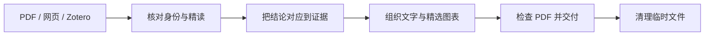

<div align="center">

# 📚 Research Paper Report

### 读懂问题，看清方法，核对证据。

一个把学术论文整理成精简图文阅读报告的 Codex Skill。

[](SKILL.md)
[](#-把论文交给它)
[](#-从论文到报告)
[](LICENSE)

[English](README.md) · **简体中文**

[快速上手](#-快速上手) · [报告内容](#-一份报告里有什么) · [工作流程](#-从论文到报告) · [常见问题](#-你可能还想问)

</div>

---

## ✨ 读完之后，留下真正有用的理解

这篇论文究竟在解决什么问题？哪些想法来自前人？实验真的证明了作者的主张吗？

这个 Skill 沿着这些问题展开，把**任务背景、方法脉络、关键图表与独立判断**放进一份紧凑的报告，让你回顾时能迅速找回重点。

- 🧭 **先弄懂任务。** 输入什么、输出什么、有哪些假设，进入方法细节之前先建立全局认识。
- 🧬 **追溯方法来路。** 梳理前序工作的时间线，区分继承的组件和真正新增的贡献。
- 🖼️ **把效果摆出来。** 除了核心指标和必要消融，原文有可视化时选取 1–2 张关键对比图。
- 🔎 **带着问题看证据。** 检查强基线、比较公平性、失败案例，以及结论能推到多远。
- 📚 **一次读多篇。** PDF 和链接可以混合输入，每篇各出一份报告；某篇受阻，其他照常处理。
- 🧹 **结束后收拾干净。** 检查报告后清理本次下载和中间文件，保留用户提供的原件。

> **默认输出：** 每篇论文一份中文 PDF，约 **4–5 页 A4、2500–3500 个汉字**。语言、篇幅和输出格式都可以在请求中调整。

## 📥 把论文交给它

- **📄 PDF 文件**：本地文件或上传附件；有 OCR 工具时可处理扫描件。
- **🌐 论文网页与 DOI**：根据可访问性和完整性选择网页全文或 PDF。
- **📎 Zotero 引文与链接**：拖入或粘贴引文、外部网址，或提供可读取的附件。
- **🗂️ 多篇混合输入**：不用统一格式，一次提供多篇即可。

Zotero 支持针对你提供的内容，不代表自动连接整个文献库。仅有 `zotero://` 内部条目链接时，可能无法直接读取全文。

## 🚀 快速上手

### 1. 安装 Skill

在仓库中选择 **Code → Download ZIP**，解压后，把仓库内容放进 `$CODEX_HOME/skills` 下名为 `paper-reading-report` 的文件夹。未设置 `CODEX_HOME` 时，使用 `~/.codex/skills`。

最终目录应类似：

```text
~/.codex/skills/paper-reading-report/SKILL.md
```

仓库名是 **`research-paper-report`**；安装目录和调用名仍是 **`paper-reading-report`**。

使用默认目录时，也可以通过 Git 安装：

```sh
git clone https://github.com/ypqlvkxx/research-paper-report.git "$HOME/.codex/skills/paper-reading-report"
```

如果设置了自定义 `CODEX_HOME`，请把目标路径改为其下的 `skills/paper-reading-report`。

这是供 Codex 执行的流程指令，并非独立软件。运行环境需要文件操作，以及 PDF 提取、生成、渲染和检查能力，可配合可用的 PDF Skill 使用。网页获取需要网络权限，扫描件可能需要 OCR，中文排版需要相应字体。

### 2. 附上论文，开始阅读

新建 Codex 对话，上传文件或粘贴链接，然后使用下面的提示词。

**📄 读一篇**

```text
使用 $paper-reading-report 精读这篇论文，生成一份精简的 PDF 阅读报告。
```

**📚 一次读多篇**

```text
使用 $paper-reading-report 分析这些 PDF 和论文链接。
每篇生成独立的 PDF 报告。如果某篇无法获取全文，说明原因并继续其他论文。
```

**🌍 改成英文报告**

```text
使用 $paper-reading-report 分析这篇论文，用英文撰写 PDF 报告，
控制在五页左右，保留最有解释力的可视化对比。
```

## 🧠 一份报告里有什么？

从**“这个任务在做什么”**，一路走到**“这篇工作值得借鉴什么”**。内容可以合并组织，避免每个小点都展开成一大段。

<details>
<summary><strong>🧭 搞清问题与研究脉络</strong></summary>

- 论文信息与细粒度研究领域分类。
- 任务背景：用途、输入数据、必要先验和输出形式。
- 一句话总结，以及交代动机、方法和主要发现的一段话总结。
- 前序方法时间线、论文指出的不足，以及这些批评是否成立。
- 直接工作基础：前序论文、骨干、预训练模型、数据集及后处理。

</details>

<details>
<summary><strong>🔬 理解方法，检查结果</strong></summary>

- 核心创新点和凝练的方法模块说明。
- 有助于理解时，加入方法图或少量关键公式。
- 数据集、划分、基线、训练设置、可得的参数量与资源成本。
- 精选主结果和必要消融。
- 原文提供可视化时，加入 1–2 张关键对比图，解释具体改善与残留缺陷。

</details>

<details>
<summary><strong>⚖️ 评判证据与创新价值</strong></summary>

- 实验是否支持各个模块，以及是否具有更广泛的参考价值。
- 有依据的质量判断：是否简单且有效，实现和资源成本如何。
- 2–3 条与实际局限对应的后续方向。
- 创新主要来自方法、数据、训练机制、工程整合，还是问题叙事。
- 来源、图表编号，以及实际阅读和验证范围。

</details>

完整要求见 [中文报告模板](references/report-outline.md) 或 [English report outline](references/report-outline.en.md)。

## 🔄 从论文到报告



批量处理时，每篇使用独立的证据记录、临时目录和报告文件名。同一论文的重复输入会在核对身份与版本后归并。失败条目会注明原因，已完成的报告照常交付。

## 🤔 你可能还想问

<details>
<summary><strong>遇到付费墙或人机验证怎么办？</strong></summary>

说明实际障碍，停止该篇的获取。瞬时连接失败只进行有限且有依据的重试，不用摘要或仓库 README 冒充全文精读。后续提供本地 PDF 或其他可读来源即可继续。

详细策略见 [网页获取说明](references/web-access.md)。

</details>

<details>
<summary><strong>会不会只是照着作者的话复述？</strong></summary>

流程要求独立判断：核查比较条件，区分已有技术与创新，评估消融，指出证据不足的主张。缺失设置标注为“未报告”；图表和结果必须来自论文或实际数据，不补造不存在的证据。完成阅读报告不等于复现了实验。

</details>

<details>
<summary><strong>哪些文件会被清理？</strong></summary>

默认保留各篇最终报告，检查完成后删除本次创建的下载正文、补充材料、提取文本、渲染页、裁图和临时脚本。用户提供的 PDF 原件、Zotero 附件、已有报告和无关文件会保留。你也可以明确要求保留其他成果。

</details>

<details>
<summary><strong>Skill 本身有英文版吗？</strong></summary>

有。[SKILL.md](SKILL.md) 是当前生效的中文入口，[SKILL.en.md](SKILL.en.md) 是完整英文版，并配有英文参考文件。要以英文指令作为入口，可把 `SKILL.en.md` 的内容复制到 `SKILL.md`，同时保留它链接的 `.en.md` 文件。指令语言不会自动改变报告默认语言；需要英文报告时在请求中说明。`agents/openai.yaml` 的界面信息仍为中文。

</details>

## 🗃️ 仓库导航

```text
research-paper-report/
├── README.md                       # English guide
├── README.zh-CN.md                 # 中文说明
├── LICENSE                         # MIT
├── SKILL.md                        # 生效的中文指令
├── SKILL.en.md                     # 英文指令
├── agents/openai.yaml              # Skill 界面信息
└── references/
    ├── report-outline.md           # 中文报告模板
    ├── report-outline.en.md        # 英文报告模板
    ├── web-access.md               # 中文获取策略
    └── web-access.en.md             # 英文获取策略
```

## 🤝 一起让下一份报告更好

欢迎提出建议和小而明确的改进。反馈问题时，说明输入类型、预期行为和实际发生的情况，会更容易定位。修改流程时，请保持中英文指令与参考文件一致。

## 📄 许可证

作者与维护者：[@ypqlvkxx](https://github.com/ypqlvkxx)。本项目采用 [MIT 许可证](LICENSE)。
